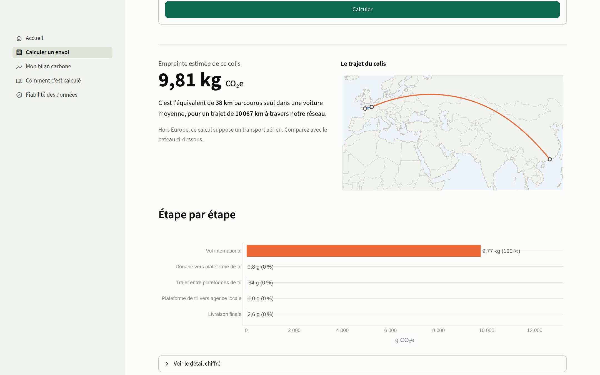
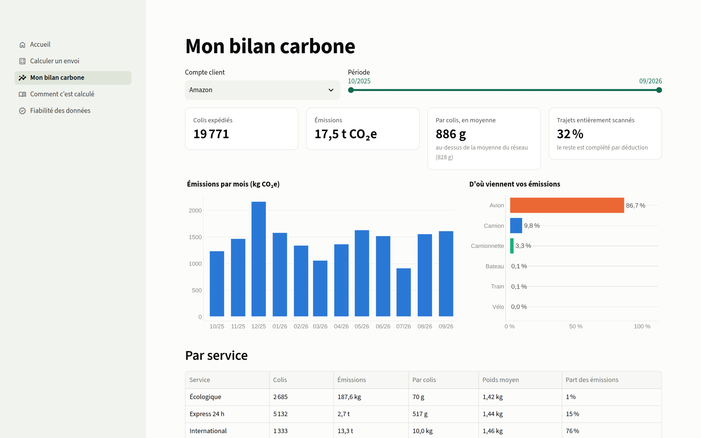
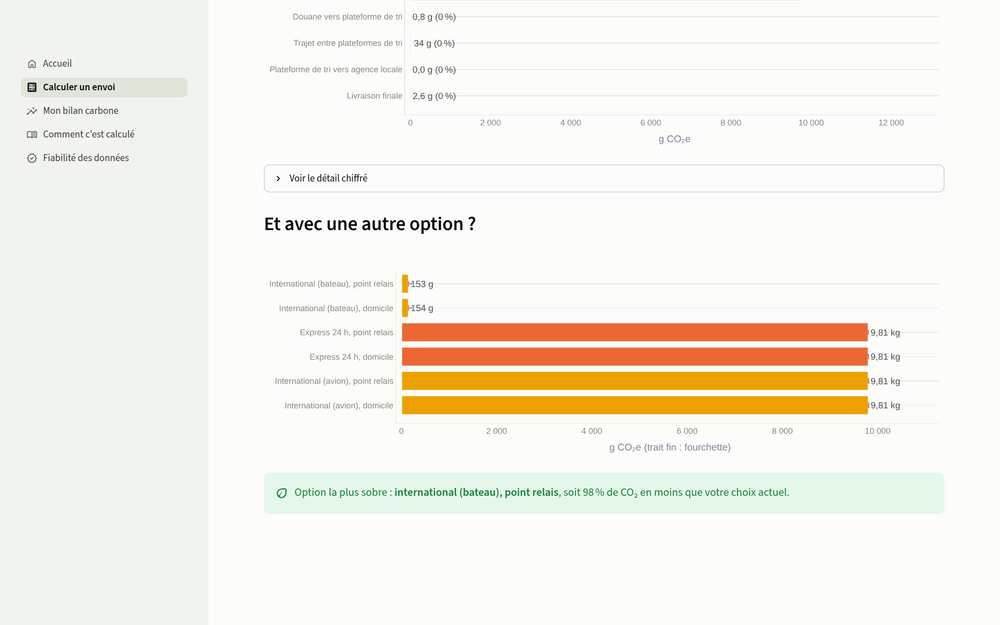

# Calculateur CO₂ logistique intelligent

Projet final de Data Wrangling (PGE3, aivancity). L'entreprise de livraison FastColis veut proposer à ses clients grands comptes (Amazon, Vinted, Shein...) l'empreinte carbone de **chaque colis**, même quand la chaîne logistique n'est que partiellement observée.

Le projet livre trois choses :

1. un **pipeline de data wrangling** qui transforme des sources hétérogènes et incomplètes (export SAP, logs de scanners, annuaire Excel des transporteurs) en une table propre, une ligne par colis, avec son émission étape par étape ;
2. une **interface Streamlit** pour un client non technique : calculer un envoi, consulter son bilan, comprendre la méthode ;
3. une **présentation** et une documentation complète.



## Résultats clés

| | |
|---|---|
| Colis traités | 60 000 (octobre 2025 à septembre 2026), 263 000 étapes de transport |
| Émissions totales | 49,7 t CO₂e, 89 g pour le colis médian |
| Message principal | les colis passés par l'avion font **12 % des envois et 84 % des émissions** |
| Un kilo venu d'Asie | 8,6 kg CO₂e par avion, 182 g par bateau (× 47) |
| Option écologique | − 41 % par kilo face au standard ; l'express n'émet pas plus que le standard |
| Précision | **2,2 % d'erreur médiane** par colis, biais de 0,5 % sur le total, mesurés contre la vérité terrain |
| Durée du pipeline | environ 90 secondes de bout en bout |

## Les sources

| Source | Format | Nature |
|---|---|---|
| Export SAP des commandes | CSV Windows-1252, `;`, virgule décimale, noms de colonnes SAP | simulée |
| Flashages (scans) | 12 fichiers JSON Lines, deux générations de firmware | simulée |
| Annuaire des transporteurs | Excel, deux onglets aux colonnes différentes | simulée |
| Référentiel des sites | CSV (villes réelles) | simulée |
| [Base Carbone ADEME](https://data.ademe.fr/datasets/base-carboner) | CSV latin-1 de 18 616 lignes | réelle, licence ouverte |
| [GeoNames cities5000](https://download.geonames.org/export/dump/) | TSV | réelle, CC BY 4.0 |
| [OpenFlights airports](https://github.com/jpatokal/openflights) | CSV | réelle, ODbL |
| [OSRM](https://project-osrm.org/) sur OpenStreetMap | API, 16 512 distances routières mises en cache | réelle, ODbL |
| [searoute](https://pypi.org/project/searoute/) | bibliothèque Python, routes maritimes | réelle |

Le cours autorise des fichiers fictifs pour les données internes. Elles sont générées par `co2/simulation.py` avec les défauts que l'on rencontre en vrai (scans oubliés ou en double, grammes saisis comme des kilos, GPS inversés, codes de site historiques, transporteurs non renseignés, horloges décalées...). La simulation garde une **vérité terrain** à part (`data/sources/_verite_terrain`), que le pipeline ne lit jamais : elle sert uniquement à mesurer sa précision et son taux de détection des défauts.

## Le pipeline

```
data/external  (ADEME, GeoNames, OpenFlights, cache OSRM)      data/sources  (SAP, flashages, transporteurs, sites)
        │                                                              │
        └──────────────────────────────┬───────────────────────────────┘
                                       ▼
 1. Découverte        co2/decouverte.py       rapport de profilage par « formes »   → reports/01_decouverte.md
 2. Ingestion         co2/ingestion.py        couche brute tracée (fichier, ligne)  → data/raw
 3. Nettoyage         co2/nettoyage.py        unités, dates, codes, doublons        → data/raw_clean + journal
 4. Enrichissement    co2/enrichissement.py   géocodage, topologie apprise,         → data/enriched
                                              trajets reconstitués, distances
 5. Features et ML    co2/features.py         véhicules, facteurs, émissions,
                      co2/modele.py           3 modèles comparés à une règle
 6. Validation        co2/validation.py       13 règles + vérité terrain            → reports/06_rapport_qualite.md
 7. Publication       co2/publication.py      table Curated, bilans Excel clients   → data/curated
```

Les points les plus intéressants :

* **Découverte par les formes** : chaque valeur est réduite à sa forme (`20260314` devient `9{8}`, `14.03.2026` devient `99.99.9{4}`), ce qui révèle les formats concurrents avant d'écrire la moindre règle.
* **Topologie apprise** : le pipeline ne reçoit aucune carte du réseau. Il apprend, dans les scans, quelle plateforme de tri dessert chaque agence et chaque entrepôt, puis s'en sert pour réinsérer les passages non flashés (15,8 % des colis).
* **Facteurs traçables** : les 22 facteurs d'émission sont extraits de la Base Carbone par leur identifiant officiel, jamais recopiés à la main.
* **Distances par mode** : route réelle OSRM, orthodromie + 95 km pour l'avion (norme EN 16258), route maritime réelle pour le bateau.
* **Apprentissage là où les données manquent** : mode d'un colis étranger dont l'entrée n'est pas flashée (98,5 % contre 87,4 % pour la règle par pays), véhicule d'une étape sans transporteur (facteur pondéré par les probabilités pour un total sans biais), émission d'un envoi à partir de la seule commande (16,8 % d'erreur contre 55,7 % pour une règle naïve, intervalle conformalisé à 80 %).

Méthode détaillée : [`docs/methodologie.md`](docs/methodologie.md). Colonnes : [`docs/dictionnaire_donnees.md`](docs/dictionnaire_donnees.md).

## Installation

```bash
python -m venv .venv
source .venv/bin/activate            # Windows : .venv\Scripts\activate
pip install -r requirements.txt
```

## Utilisation

```bash
python run_pipeline.py                      # tout le pipeline (≈ 90 s), sources régénérées si absentes
python run_pipeline.py --regenerer-sources  # repart de zéro, y compris les fichiers simulés
python run_app.py                           # interface sur http://localhost:8501
python -m pytest tests                      # 17 tests
python notebooks/construire_notebook.py     # réexécute le notebook et son export HTML
```

Le notebook [`notebooks/co2_pipeline.ipynb`](notebooks/co2_pipeline.ipynb) (et sa version [HTML](notebooks/co2_pipeline.html)) déroule les étapes du cours avec leurs sorties. Il ne contient pas de logique : il appelle les modules.

## L'interface

| Page | Pour qui, pour quoi |
|---|---|
| Accueil | les chiffres clés et ce qui pèse vraiment |
| Calculer un envoi | départ (ville, entrepôt ou étranger), arrivée, poids, service : l'empreinte, sa fourchette, le trajet sur une carte, le détail par étape et la comparaison des options |
| Mon bilan carbone | par compte client et par période : émissions mensuelles, répartition par mode et par service, simulation de trois leviers, export Excel |
| Comment c'est calculé | la méthode en langage clair, les facteurs ADEME, les limites |
| Fiabilité des données | les règles de contrôle, les erreurs corrigées, le journal complet |

| Mon bilan carbone | Comparaison des options |
|---|---|
|  |  |

Guide pas à pas pour un utilisateur : [`docs/guide_utilisateur.md`](docs/guide_utilisateur.md).

## Arborescence

```
co2/                 le paquet du pipeline (un module par étape) + calculateur et figures
app/                 interface Streamlit (app.py, commun.py, vues/)
data/external/       référentiels publics téléchargés
data/sources/        extractions internes simulées + vérité terrain (évaluation uniquement)
data/curated/        table finale colis_co2 (Parquet et CSV), étapes, bilans Excel par client
data/models/         modèle d'émission entraîné et ses métriques
reports/             rapports de découverte et de qualité, journal, figures, log d'exécution
notebooks/           notebook exécuté et son export HTML
presentation/        diapositives (.pptx et .pdf) et script de génération
docs/                méthodologie, dictionnaire, gestion de projet, guide utilisateur, captures
tests/               tests unitaires
```

Les couches intermédiaires `data/raw`, `data/raw_clean` et `data/enriched` sont régénérées par `run_pipeline.py` et ne sont pas versionnées (sauf les deux petites tables dont l'interface a besoin).

## Gestion de projet

Démarche Scrum : vision produit, 4 epics, backlog de user stories, 3 sprints de deux semaines, tableau Kanban et Definition of Done. Détail : [`docs/gestion_projet.md`](docs/gestion_projet.md).

## Équipe

Kheireddine BOUADI, Maël RAZAFIMBELO, Mohamed BEN AMOR, Ael Boece NGODA LONTSI, Abdallah BENSMAIL.
